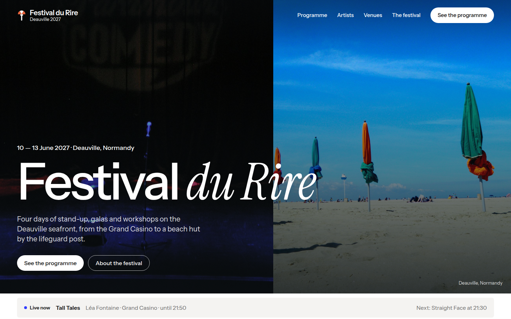
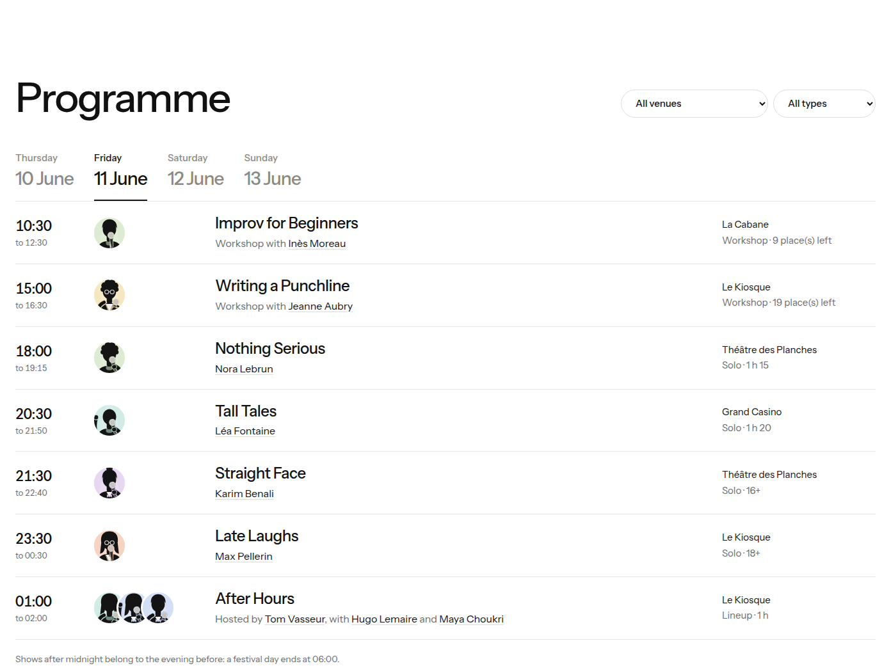
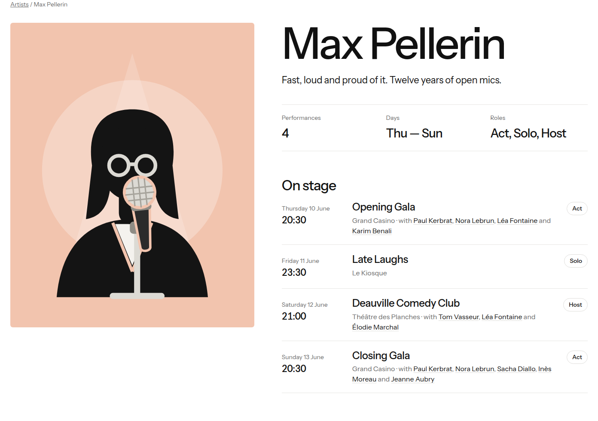
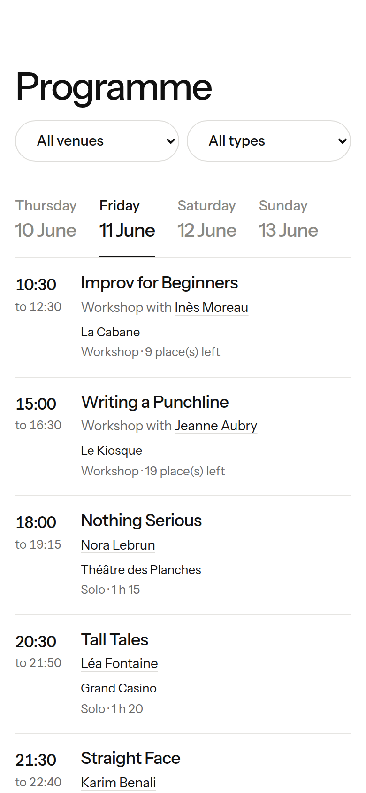
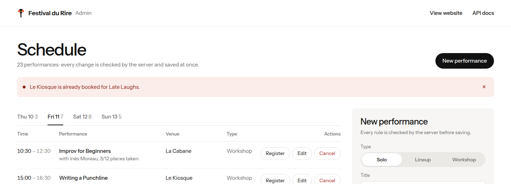

# Festival du Rire — Deauville 2027

Le programme du **Deauville Festival du Rire** (10-13 juin 2027), de A à Z en
Python : des classes pour les lieux, les artistes et les performances, une
ligne de commande, une API JSON (FastAPI), un site public et une admin pour
les organisateurs. Toutes les règles du festival sont vérifiées au même
endroit, et chaque refus est une phrase claire.



Projet du cours de programmation orientée objet, ECE Paris 2026-2027. Les
fiches du cours sont dans `B1/` à `B5/` (voir [COURSE.md](COURSE.md)).

## Sommaire

- [Aperçu](#aperçu)
- [Démarrage rapide](#démarrage-rapide)
- [Commandes](#commandes)
- [Structure du projet](#structure-du-projet)
- [Documentation complète](#documentation-complète)
- [État du projet](#état-du-projet)

## Aperçu

### Le site public

Le programme se lit jour par jour, se filtre par lieu et par type, et chaque
nom d'artiste mène à sa page. Une journée du festival se termine à 06:00 :
les spectacles d'après minuit appartiennent à la soirée de la veille.



| Page d'un artiste | Sur téléphone |
| --- | --- |
|  |  |

### L'admin des organisateurs

Programmer, déplacer, annuler un spectacle, inscrire un participant à un
atelier, ajouter un artiste. L'admin ne contient aucune règle : elle envoie la
demande à l'API, et le serveur accepte ou refuse avec une phrase.



## Démarrage rapide

Il faut [uv](https://docs.astral.sh/uv/) (et Python 3.12, que uv installe si
besoin).

```bash
git clone https://github.com/elfried96/deauville-festiElf.git
cd deauville-festiElf
uv sync
uv run deauville serve
```

Puis ouvrir :

| Adresse | Contenu |
| --- | --- |
| <http://127.0.0.1:8000/> | le site public |
| <http://127.0.0.1:8000/?at=2027-06-11T21:00> | le site « comme si » on était le vendredi à 21:00 |
| <http://127.0.0.1:8000/admin/> | l'admin |
| <http://127.0.0.1:8000/docs> | la documentation interactive de l'API |

L'admin écrit dans `data/festival.json`. Pour essayer sans toucher aux
vraies données :

```bash
cp data/festival.json /tmp/essai.json
uv run deauville serve --data /tmp/essai.json
```

## Commandes

```bash
uv run deauville                              # résumé du festival
uv run deauville venues                       # les lieux et leurs places
uv run deauville programme 2027-06-11         # le programme d'une journée
uv run deauville artist max-pellerin          # les passages d'un artiste, avec son rôle
uv run deauville now 2027-06-11T21:00         # sur scène à ce moment, et la suite
uv run deauville stats                        # les questions de l'étape 01
uv run deauville add                          # ajouter un solo (questions posées)
uv run deauville cancel le-kiosque-2027-06-12-0100
uv run deauville serve [--port 8001]          # le site, l'admin et l'API
```

Chaque commande accepte `--data FICHIER` pour travailler sur un autre fichier
que `data/festival.json`.

Les outils du projet :

```bash
uv run pytest -v          # 75 tests ; aucun ne touche data/festival.json
uv run ruff check .       # le style
uv run ruff format .      # la mise en forme
uv build                  # dist/deauville-0.1.0-py3-none-any.whl
```

## Structure du projet

```
src/deauville/          le programme (un module par sujet)
├── errors.py           la famille d'erreurs du festival
├── storage.py          Storage (interface), JSONStorage, MemoryStorage
├── models.py           Venue, Artist, Performance et ses trois sous-classes
├── festival.py         Festival : les collections et les règles ; load/save
├── api.py              create_app(storage) : les routes d'API.md, le site, l'admin
└── cli.py              main() : la commande `deauville`
web/
├── public/             le site : index.html, artist.html, app.js, style.css, images/
└── admin/              l'admin : index.html, admin.js, admin.css
tests/
├── test_festival.py    les règles, directement sur les objets
└── test_api.py         tout API.md par HTTP, sur un stockage en mémoire
data/festival.json      les données du festival
API.md                  le contrat de l'API
docs/                   la documentation complète
```

Chaque module ne dépend que de ceux du dessus de la liste : `errors` ne
dépend de rien ; `api` et `cli` sont tout en bas et ne contiennent aucune
règle. Le site et l'admin ne parlent qu'à l'API.

En une phrase par idée :

- **Héritage et polymorphisme** : `SoloShow`, `Lineup` et `Workshop`
  héritent de la classe abstraite `Performance` ; le code n'écrit jamais
  `if kind == ...`.
- **Encapsulation** : `Festival` garde ses listes privées et ne les change
  que par des méthodes qui vérifient les règles.
- **Ses propres erreurs** : le type de l'erreur donne le code HTTP (404, 409,
  422, 500), le message dit quelle règle.
- **Un stockage remplaçable** : le festival ne sait pas s'il vit dans un
  fichier JSON ou en mémoire ; une base de données serait une classe de plus.

Le détail, avec des schémas, est dans [docs/architecture.md](docs/architecture.md).

## Documentation complète

| Document | Pour qui, pour quoi |
| --- | --- |
| [Guide d'utilisation](docs/guide-utilisation.md) | utiliser le site, l'admin et la ligne de commande, pas à pas |
| [Architecture](docs/architecture.md) | les modules, les classes, où vivent les règles, une route de l'URL à la règle |
| [Interface](docs/interface.md) | le site et l'admin : fichiers, design, appels à l'API |
| [Développement](docs/developpement.md) | tests, outils, et comment ajouter une fonctionnalité |
| [Crédits](docs/credits.md) | auteurs et licences des photos du site |
| [API.md](API.md) | le contrat de l'API, route par route |

## État du projet

Fait (étapes 00 à 13 du cours, plus le design) :

- toutes les commandes de la ligne de commande, avec `--data` et `--port` ;
- tout `API.md` : lecture, écriture (admin), erreurs ;
- le site public (ouverture en photos, chiffres clés, programme filtrable,
  histoire, artistes en portraits dessinés, lieux, « Live now ») et l'admin,
  sur ordinateur et téléphone, avec un logo ;
- 75 tests, `ruff` propre, annotations et docstrings, `uv build`, et un
  clone neuf qui marche.

Pas fait :

- l'extension SQLite ;
- `deauville add` n'ajoute que des solos (plateaux et ateliers passent par
  l'admin) ;
- les photos des artistes : ils sont fictifs, donc représentés par des
  portraits dessinés, remplacés automatiquement par une photo dès que leur
  `photo_url` est renseigné.

Limites connues :

- Le fichier de données et le dossier `web/` sont cherchés à côté du code
  (`uv sync` installe le projet en mode éditable, donc tout marche depuis le
  dépôt). Installée ailleurs avec la wheel, la commande a besoin de
  `--data`, et le site ne serait pas trouvé.
- Chaque requête recharge et réécrit tout le fichier, sans verrou : de deux
  écritures exactement simultanées, la dernière gagne.
- `/api/now` sans `?at=` utilise l'heure de la machine, sans fuseau horaire.
- Les polices (Instrument Sans et Instrument Serif) viennent de Google Fonts :
  hors ligne, le site utilise des polices système proches.
