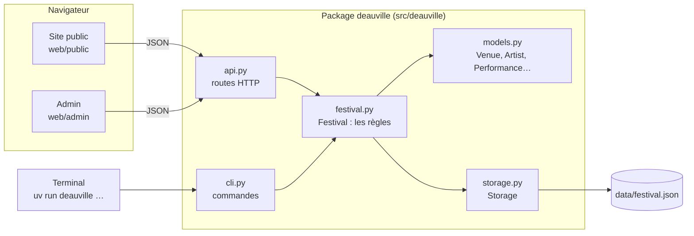
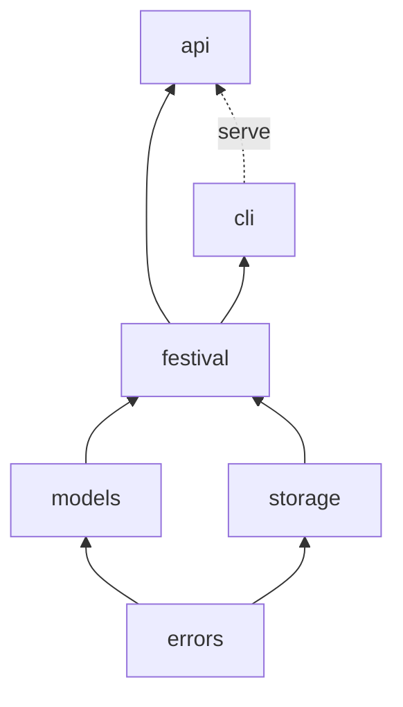
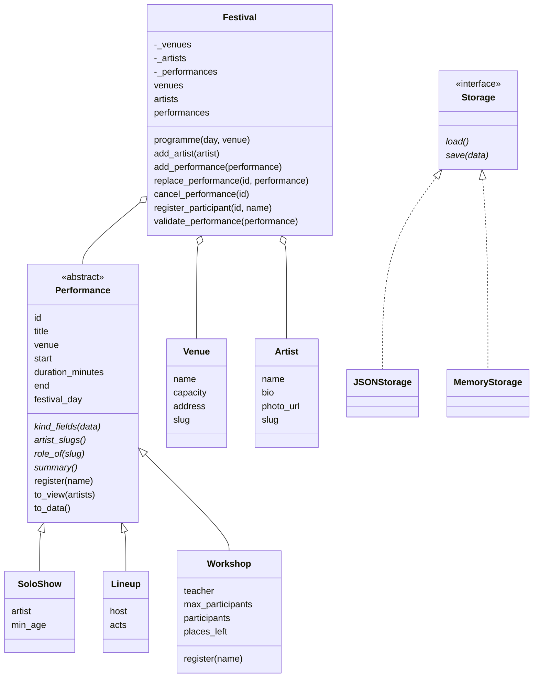
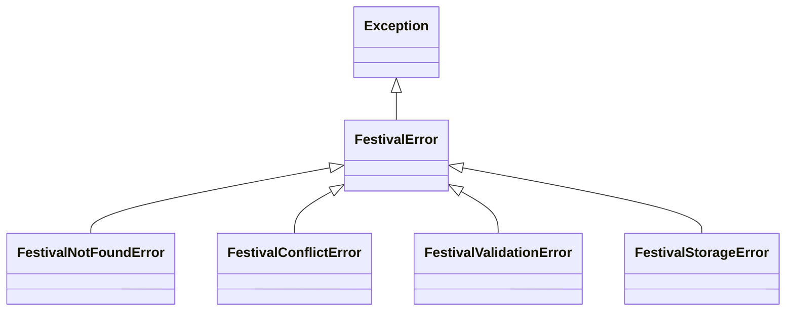
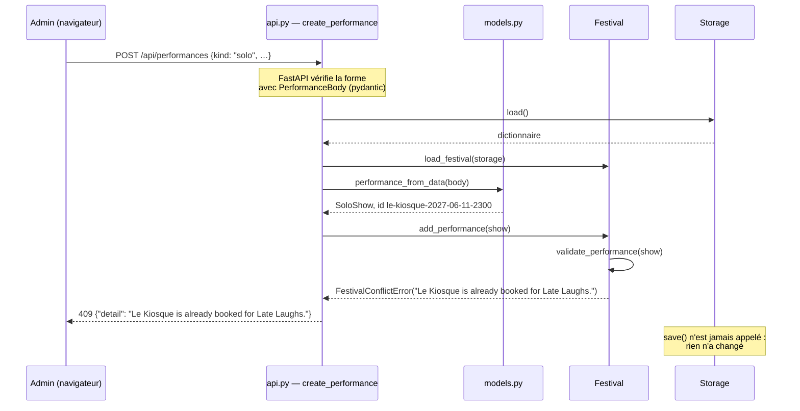

# Architecture

Comment le programme est découpé, et pourquoi. Les schémas sont en
[Mermaid](https://mermaid.js.org/) : GitHub les dessine directement.

[← Retour au README](../README.md)

## Sommaire

- [Vue d'ensemble](#vue-densemble)
- [Les modules](#les-modules)
- [Les classes](#les-classes)
- [Où vivent les règles](#où-vivent-les-règles)
- [Les erreurs](#les-erreurs)
- [Une route, de l'URL à la règle](#une-route-de-lurl-à-la-règle)
- [Le stockage](#le-stockage)
- [Le fichier de données](#le-fichier-de-données)
- [Choix et compromis](#choix-et-compromis)

## Vue d'ensemble



Trois portes d'entrée (le site, l'admin, le terminal) mènent au même objet
`Festival`, qui fait respecter les règles. Le site et l'admin n'ont aucun
accès direct aux données : ils ne parlent qu'à l'API.

## Les modules

Un module par sujet. Chacun ne dépend que des modules au-dessus de lui dans ce
tableau, jamais l'inverse :

| Module | Contenu | Dépend de |
| --- | --- | --- |
| `errors.py` | `FestivalError` et ses quatre sous-classes | rien |
| `storage.py` | `Storage` (interface), `JSONStorage`, `MemoryStorage` | `errors` |
| `models.py` | `Venue`, `Artist`, `Performance`, `SoloShow`, `Lineup`, `Workshop`, `performance_from_data()` | `errors` |
| `festival.py` | `Festival`, `load_festival()`, `save_festival()` | `errors`, `models`, `storage` |
| `api.py` | `create_app(storage)` : les routes, le site, l'admin | tout ce qui précède |
| `cli.py` | `main()` : la commande `deauville` | tout ce qui précède |



Les erreurs ont leur propre module pour éviter un import circulaire :
`storage.py` doit lever `FestivalStorageError`, et `festival.py` importe
`storage.py`.

## Les classes



### `Venue` et `Artist`

Des dataclasses : des données simples. Le **slug** (`max-pellerin`) est une
propriété calculée à partir du nom : il ne peut pas être faux ni
désynchronisé. Deux artistes au même slug sont égaux, donc `Zoé Tanguy` et
`zoe tanguy` sont le même artiste.

### `Performance` et ses trois sous-classes — héritage et polymorphisme

`Performance` est une **classe abstraite** : on ne peut pas créer « une
performance » sans dire laquelle. Elle porte tout ce qui est commun (les
horaires, `end`, `festival_day`, l'ordre du programme, la vue JSON). Ses
méthodes abstraites obligent chaque type à dire ce qui lui est propre :

| Méthode | `SoloShow` | `Lineup` | `Workshop` |
| --- | --- | --- | --- |
| `artist_slugs()` | `[artist]` | `[host, *acts]` | `[teacher]` |
| `role_of(slug)` | `"solo"` | `"host"` ou `"act"` | `"teacher"` |
| `summary()` | le nom de l'artiste | `hosted by …, with …` | `with …, 3/12 places taken` |
| `register(name)` | refuse | refuse | inscrit, si la place le permet |

Chaque sous-classe appelle `super().__init__()` puis vérifie ses propres
règles. Le reste du code n'écrit **jamais** `if kind == "solo"` : il appelle
`performance.summary()` et Python choisit la bonne méthode. Pour créer la
bonne classe à partir d'un dictionnaire (fichier JSON, corps d'une requête,
ligne de commande), une seule fonction, `performance_from_data()`, regarde
le champ `kind` dans la table `PERFORMANCE_CLASSES` :

```python
PERFORMANCE_CLASSES = {cls.kind: cls for cls in (SoloShow, Lineup, Workshop)}
```

Ajouter un quatrième type, c'est écrire une sous-classe et l'ajouter à
cette table : aucune route, aucune commande ne change.

### `Festival` — encapsulation

`Festival` garde ses listes **privées** (`_venues`, `_artists`,
`_performances`). On les lit par des propriétés qui renvoient une **copie** :

```python
festival.performances.clear()   # vide une copie : le festival n'a pas bougé
```

On ne les change que par des méthodes qui vérifient les règles :
`add_artist`, `add_performance`, `replace_performance`,
`cancel_performance`, `register_participant`. De même, `Lineup.acts` et
`Workshop.participants` renvoient des copies : on s'inscrit seulement par
`register()`. Personne ne peut contourner une règle, même par erreur.

## Où vivent les règles

Dans les objets, jamais dans les routes ni dans la ligne de commande :

| Règle | Où |
| --- | --- |
| durée de 1 à 360 minutes, titre non vide | `Performance.__init__` |
| âge minimum de 0 à 18 | `SoloShow.__init__` |
| au moins deux numéros, sans doublon, animateur hors des numéros, 10 min par numéro et 3 min entre deux | `Lineup.__init__` |
| au moins une place, pas plus d'inscrits que de places | `Workshop.__init__` |
| lieu et artistes connus, jour du festival, pas deux fois le même id | `Festival.validate_performance` |
| 30 minutes d'écart entre deux performances d'un même lieu ou d'un même artiste | `Festival.validate_performance` |
| un déplacement refusé ne change rien | `Festival.replace_performance` |
| pas deux fois le même participant, pas au-delà des places | `Workshop.register` |
| seul un atelier accepte des participants | `Performance.register` (refuse par défaut) |
| un artiste n'existe qu'une fois | `Festival.add_artist` |

`replace_performance` retire l'ancienne version, essaie d'ajouter la
nouvelle, et remet l'ancienne **à sa place** si une règle refuse :

```python
old = self.get_performance(identifier)
index = self._performances.index(old)
self._performances.remove(old)
try:
    self.add_performance(performance)
except FestivalError:
    self._performances.insert(index, old)
    raise
```

## Les erreurs



Le **type** de l'erreur dit ce qui ne va pas ; le **message** dit quelle
règle, en une phrase pour l'utilisateur :

| Exception | Sens | HTTP |
| --- | --- | --- |
| `FestivalNotFoundError` | lieu, artiste ou performance inconnu | 404 |
| `FestivalConflictError` | lieu ou artiste occupé, hors festival, atelier complet, déjà existant | 409 |
| `FestivalValidationError` | valeur invalide | 422 |
| `FestivalStorageError` | fichier illisible ou impossible à écrire | 500 |

Dans l'API, **un seul gestionnaire** traduit le type en code HTTP grâce à la
table `STATUS_CODES` : les routes n'écrivent jamais `try`.

```python
@app.exception_handler(FestivalError)
async def festival_error_handler(request, exc):
    status_code = STATUS_CODES.get(type(exc), 500)
    return JSONResponse(status_code=status_code, content={"detail": str(exc)})
```

La ligne de commande attrape toute la famille d'un coup
(`except FestivalError`) et affiche `Error: …`. Un corps ou un paramètre de
mauvaise forme (champ manquant, `?day=June 11`) est refusé **avant**, par
FastAPI et pydantic : 422, avec une liste de problèmes.

## Une route, de l'URL à la règle

`POST /api/performances` : un solo de Nora Lebrun au Kiosque à 23:00 le
vendredi, alors que *Late Laughs* y commence à 23:30.



1. FastAPI vérifie la **forme** du corps avec `PerformanceBody` (pydantic).
2. `create_performance` charge le festival depuis le stockage.
3. `performance_from_data()` choisit `SoloShow` dans `PERFORMANCE_CLASSES` et
   la construit : l'id est calculé à partir du lieu et de l'heure.
4. `Festival.add_performance` appelle `validate_performance`, qui trouve un
   chevauchement (moins de 30 minutes) au même lieu et lève
   `FestivalConflictError`.
5. Le gestionnaire d'erreurs répond **409** avec la phrase. Comme l'erreur
   arrive avant `save_festival`, rien n'est enregistré.

Si tout va bien, la route appelle `save_festival(festival, storage)` puis
renvoie **201** avec la performance.

## Le stockage

```python
class Storage(ABC):
    @abstractmethod
    def load(self) -> dict: ...

    @abstractmethod
    def save(self, data: dict) -> None: ...
```

- `JSONStorage(fichier)` lit et écrit un fichier JSON. Un fichier absent,
  abîmé ou impossible à écrire devient une `FestivalStorageError` (500).
- `MemoryStorage(données)` garde une copie en mémoire : les tests l'utilisent
  et ne touchent jamais au disque.

L'API ne crée pas son stockage : elle le **reçoit**.

```python
app = create_app(JSONStorage("data/festival.json"))   # le serveur
app = create_app(MemoryStorage(DATA))                 # un test
```

`uv run deauville serve --data copie.json` construit un `JSONStorage` sur
`copie.json` et le donne à `create_app`.

### Et avec une base de données ?

Il suffirait d'écrire une classe de plus, par exemple
`SQLiteStorage(Storage)`, avec ses propres `load()` et `save()`, et de la
choisir dans `cli.py` (une option `--db`). `create_app(storage)` la
recevrait comme les autres : aucune classe du festival ni aucune route ne
changerait.

Pour une vraie base, on voudrait ensuite éviter de tout recharger et tout
réécrire à chaque requête : l'interface `Storage` grandirait
(`add_performance`, `delete_performance`…) pour ne toucher qu'une ligne.

## Le fichier de données

`data/festival.json` contient le festival, ses lieux, ses artistes et ses
performances :

```json
{
  "name": "Deauville Festival du Rire 2027",
  "first_day": "2027-06-10",
  "last_day": "2027-06-13",
  "venues": [
    {"name": "Grand Casino", "capacity": 650, "address": "Seafront, main hall"}
  ],
  "artists": [
    {"name": "Hugo Lemaire", "bio": "Musical comedy with a ukulele…", "photo_url": ""}
  ],
  "performances": [
    {
      "kind": "solo",
      "title": "Family Business",
      "venue": "theatre-des-planches",
      "start": "2027-06-10T21:00",
      "duration_minutes": 75,
      "artist": "sacha-diallo",
      "min_age": 0
    }
  ]
}
```

- Les slugs (`theatre-des-planches`, `sacha-diallo`) ne sont pas stockés pour
  les lieux et les artistes : ils sont calculés à partir des noms.
- L'id d'une performance est toujours recalculé : lieu + début
  (`theatre-des-planches-2027-06-10-2100`).
- Les champs propres à chaque type : `artist` et `min_age` (solo), `host` et
  `acts` (plateau), `teacher`, `max_participants` et `participants`
  (atelier).
- Les heures sont locales, sans fuseau horaire. Une journée du festival
  finit à 06:00 : `festival_day` d'une performance à 01:00 le samedi est le
  vendredi.

## Choix et compromis

| Choix | Pourquoi | Ce qu'il coûte |
| --- | --- | --- |
| Recharger le fichier à chaque requête | simple, toujours à jour, aucun état caché dans le serveur | lent avec beaucoup de données ; pas de verrou entre deux écritures simultanées |
| L'id calculé (lieu + heure) | lisible, unique par construction (deux spectacles ne peuvent pas commencer au même endroit à la même heure) | déplacer un spectacle change son id |
| Une seule fonction `performance_from_data()` | le fichier, l'API et la ligne de commande construisent les performances de la même façon | elle doit connaître la table des types |
| Les chemins (`data/`, `web/`) cherchés à côté du code | marche tel quel depuis le dépôt (`uv sync` installe en mode éditable) | installée ailleurs avec la wheel, il faut `--data`, et le site n'est pas trouvé |
