# Guide d'utilisation

Ce guide montre comment se servir du projet sans lire le code : le site
public, l'admin des organisateurs, puis la ligne de commande.

[← Retour au README](../README.md)

## Sommaire

- [Lancer le serveur](#lancer-le-serveur)
- [Le site public](#le-site-public)
- [L'admin](#ladmin)
- [La ligne de commande](#la-ligne-de-commande)
- [Quand quelque chose est refusé](#quand-quelque-chose-est-refusé)

## Lancer le serveur

```bash
uv run deauville serve
```

Le terminal affiche les deux adresses utiles :

```
Website: http://127.0.0.1:8000/  Admin: http://127.0.0.1:8000/admin/
```

`Ctrl+C` arrête le serveur. Deux options :

| Option | Effet |
| --- | --- |
| `--data FICHIER` | utiliser un autre fichier de données (une copie pour essayer, par exemple) |
| `--port 8001` | utiliser un autre port, si le 8000 est déjà pris |

> L'admin enregistre chaque changement **tout de suite** dans le fichier de
> données. Pour essayer sans risque, travaillez sur une copie :
>
> ```bash
> cp data/festival.json /tmp/essai.json
> uv run deauville serve --data /tmp/essai.json
> ```

## Le site public

### L'accueil

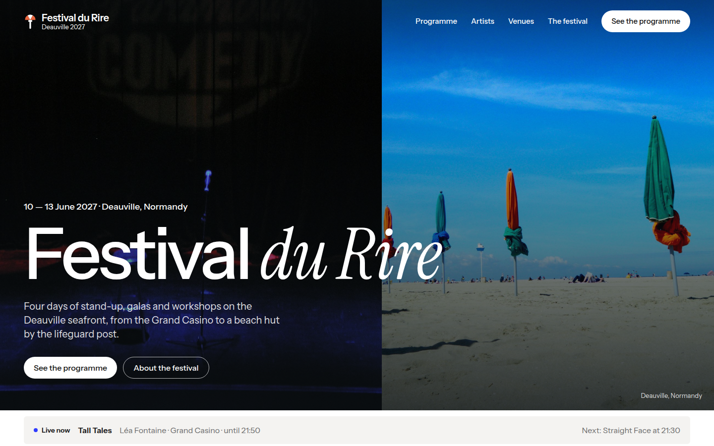

Sous l'ouverture, le bandeau gris dit ce qui se passe **maintenant** :

- pendant le festival : le spectacle en cours, son lieu, son heure de fin, et
  le suivant ;
- avant le festival : la date d'ouverture, avec un lien pour prévisualiser
  une soirée ;
- après : « The festival is over ».

Pour voir le site « comme si » on était à un moment précis, ajoutez `?at=` à
l'adresse : <http://127.0.0.1:8000/?at=2027-06-11T21:00> montre le vendredi
à 21:00.

Plus bas, les **chiffres clés** du festival et un **aperçu des 4 jours** :
le nombre de spectacles et les têtes d'affiche de chaque soirée. Cliquer sur
un jour ouvre son programme.

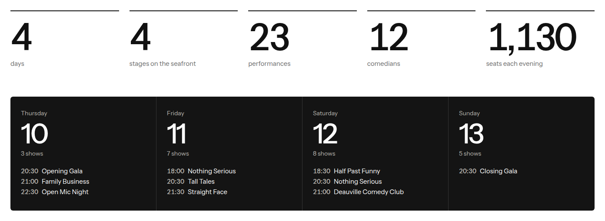

### Le programme

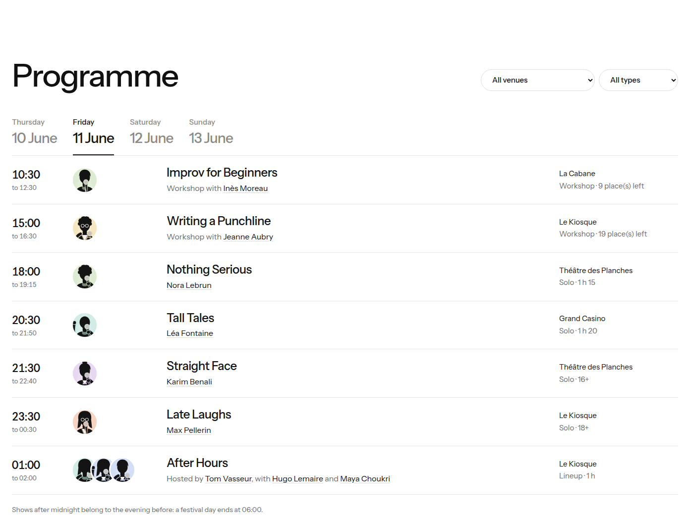

- **Les onglets** choisissent le jour.
- **Les deux filtres** gardent un seul lieu, ou un seul type (solos, plateaux,
  ateliers). Ils se combinent.
- **Chaque ligne** donne l'heure de début et de fin, les portraits des
  artistes, le titre, leurs noms (cliquables), le lieu, puis la durée, l'âge
  minimum ou les places restantes d'un atelier.

**Une journée du festival se termine à 06:00.** « After Hours », qui commence
le samedi à 01:00, est donc dans le programme du **vendredi** : c'est la fin
de la soirée du vendredi.

### L'histoire, les artistes et les lieux

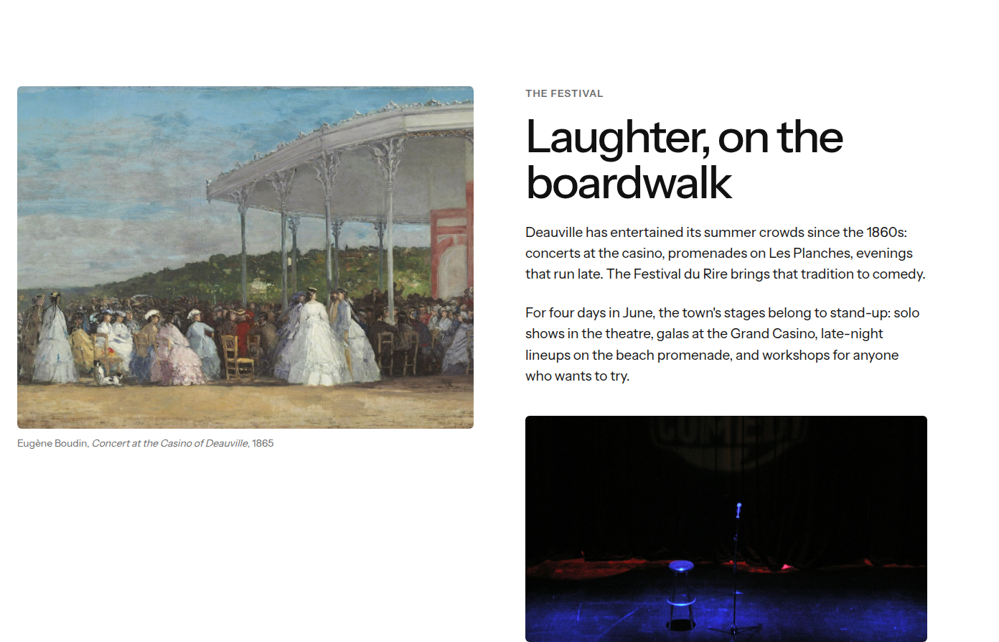

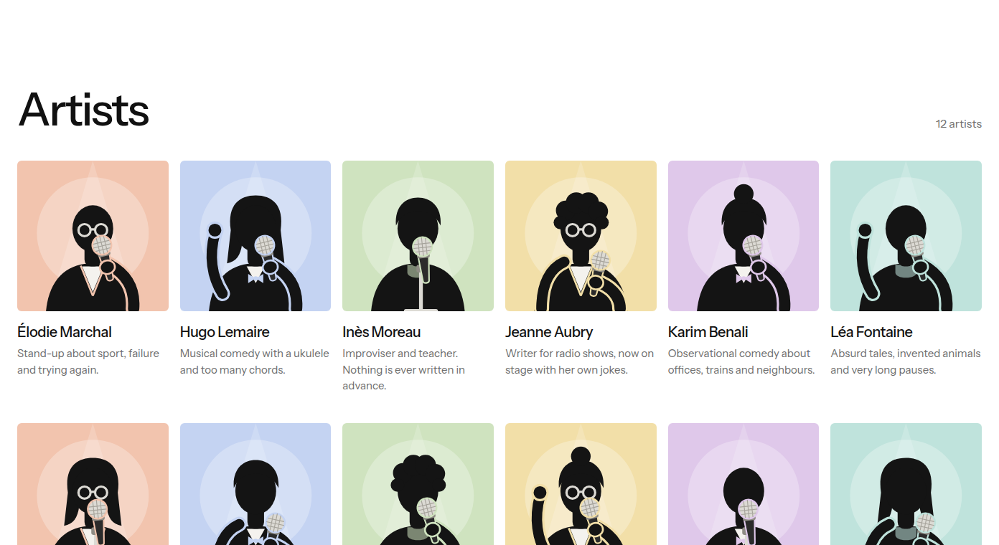

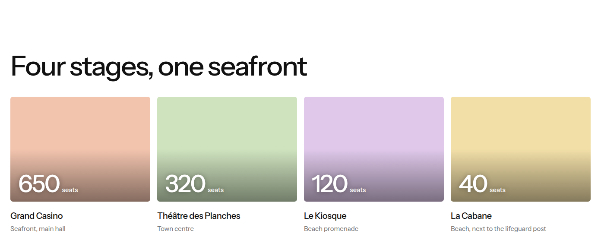

Les artistes sont représentés par des **portraits dessinés**. Dès qu'un
artiste a une adresse de photo (`photo_url`, à remplir dans l'admin à la
création de l'artiste), sa vraie photo s'affiche à la place.

### La page d'un artiste

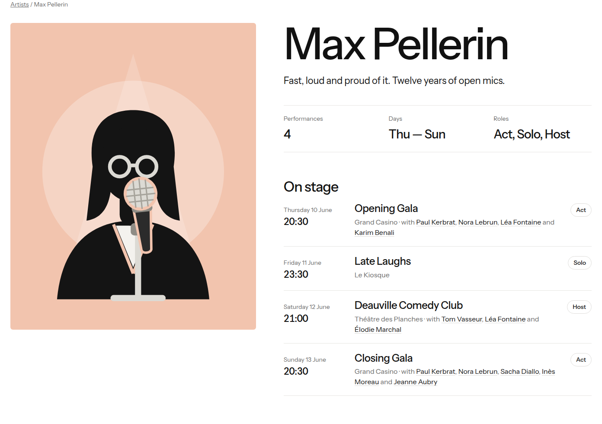

Elle donne la bio, trois chiffres (nombre de passages, jours, rôles) et la
liste de ses passages. Chaque passage indique son **rôle** :

| Rôle | Signification |
| --- | --- |
| Solo | seul en scène |
| Host | anime un plateau |
| Act | fait un numéro dans un plateau |
| Teacher | anime un atelier |

En bas, « On stage together » montre les artistes qui partagent la scène
avec lui.

### Sur téléphone

| Accueil | Programme | Artiste |
| --- | --- | --- |
| 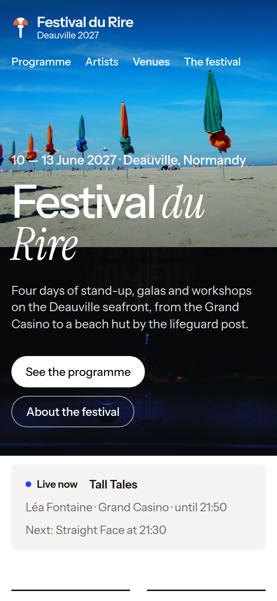 | 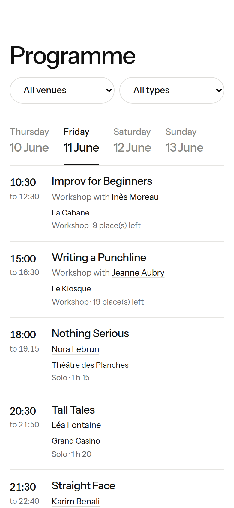 | 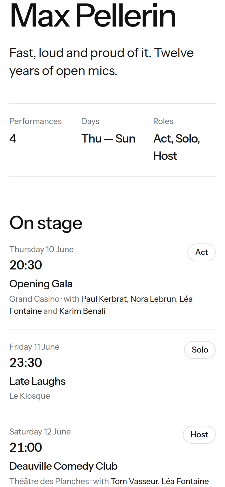 |

Le site s'adapte à l'écran : les deux photos d'ouverture passent l'une
au-dessus de l'autre, le menu se resserre, les filtres passent côte à côte,
et les chiffres clés se rangent sur deux colonnes.

## L'admin

Adresse : <http://127.0.0.1:8000/admin/>.

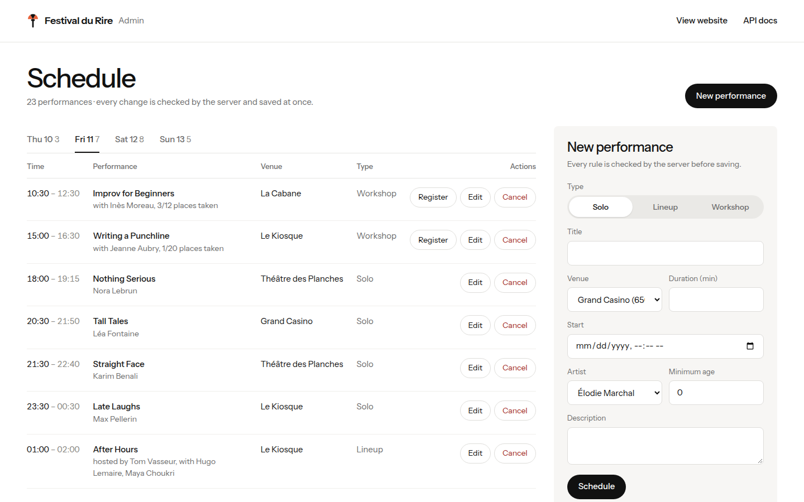

À gauche, le **planning** d'un jour (le chiffre à côté de chaque jour est le
nombre de spectacles). À droite, le **formulaire**.

### Programmer un spectacle

1. Choisir le **type** : Solo, Lineup (plateau) ou Workshop (atelier). Le
   formulaire affiche les champs de ce type.
2. Remplir le titre, le lieu, la durée, le début.
3. Selon le type :
   - **Solo** : l'artiste et l'âge minimum (0 à 18) ;
   - **Lineup** : l'animateur, puis au moins **deux** numéros cochés ;
   - **Workshop** : le professeur et le nombre de places.
4. Cliquer **Schedule**. Un message vert confirme, ou un message rouge dit
   quelle règle bloque.

### Modifier ou déplacer un spectacle

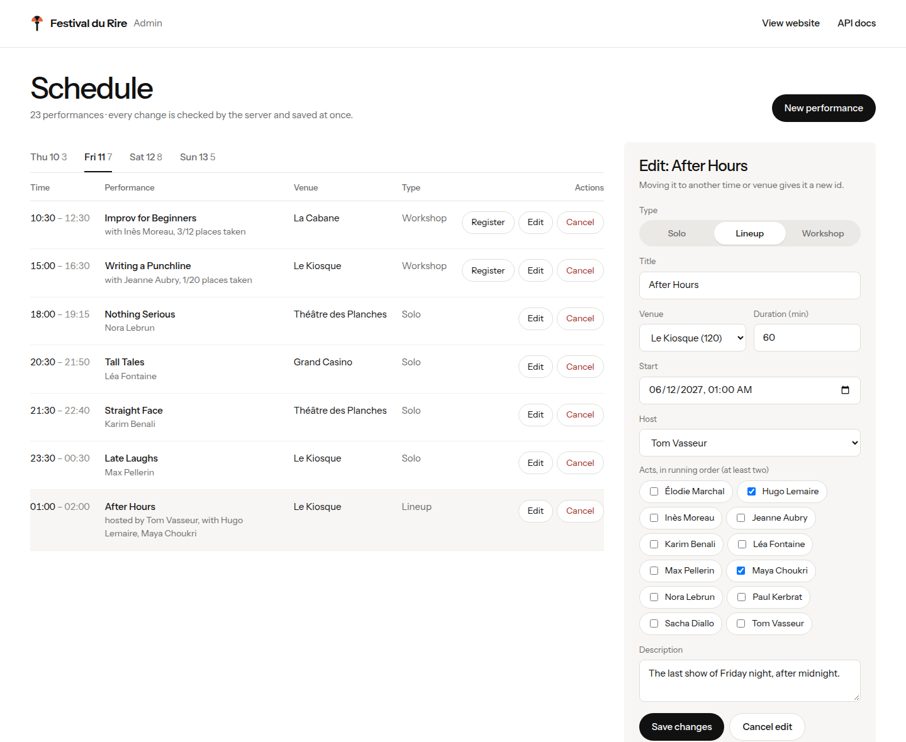

Cliquer **Edit** sur une ligne : elle se surligne et le formulaire se
remplit. Changer ce qu'il faut, puis **Save changes**.

L'identifiant d'un spectacle est fait du lieu et de l'heure
(`le-kiosque-2027-06-12-0100`) : **déplacer un spectacle change son
identifiant**. Si la nouvelle version enfreint une règle, rien ne change :
l'ancienne reste à sa place.

### Annuler un spectacle

Cliquer **Cancel** sur la ligne, puis confirmer. Le spectacle disparaît du
programme.

### Inscrire un participant à un atelier

Le bouton **Register** n'existe que sur les ateliers. Il demande le nom du
participant. Le même nom ne peut pas s'inscrire deux fois, et un atelier
complet refuse.

### Ajouter un artiste

Le formulaire « New artist » en bas à droite : un nom (obligatoire), une bio,
une adresse de photo. Deux artistes ne peuvent pas avoir le même nom, même
écrit autrement (`Zoé Tanguy` et `zoe tanguy` sont le même artiste).

## La ligne de commande

Toutes les commandes acceptent `--data FICHIER`.

### Le résumé

```
$ uv run deauville
Deauville Festival du Rire 2027
From 2027-06-10 to 2027-06-13
4 venues, 12 artists, 23 performances
```

### Les lieux

```
$ uv run deauville venues
grand-casino: Grand Casino, 650 seats
theatre-des-planches: Théâtre des Planches, 320 seats
le-kiosque: Le Kiosque, 120 seats
la-cabane: La Cabane, 40 seats
Total: 1130 seats
```

### Le programme d'un jour

```
$ uv run deauville programme 2027-06-11
Programme for Friday 11 June:
10:30-12:30 | La Cabane | Improv for Beginners (workshop)
15:00-16:30 | Le Kiosque | Writing a Punchline (workshop)
18:00-19:15 | Théâtre des Planches | Nothing Serious (solo)
20:30-21:50 | Grand Casino | Tall Tales (solo)
21:30-22:40 | Théâtre des Planches | Straight Face (solo)
23:30-00:30 | Le Kiosque | Late Laughs (solo)
01:00-02:00 | Le Kiosque | After Hours (lineup)
```

### Les passages d'un artiste

```
$ uv run deauville artist max-pellerin
Max Pellerin
Thu 10 20:30-22:30 | Grand Casino | Opening Gala (act)
Fri 11 23:30-00:30 | Le Kiosque | Late Laughs (solo)
Sat 12 21:00-22:40 | Théâtre des Planches | Deauville Comedy Club (host)
Sun 13 20:30-22:40 | Grand Casino | Closing Gala (act)
```

### Ce qui se passe à un moment donné

```
$ uv run deauville now 2027-06-11T21:00
On stage at 2027-06-11 21:00:
- Tall Tales at Grand Casino, until 21:50
Up next:
21:30-22:40 | Théâtre des Planches | Straight Face (solo)
23:30-00:30 | Le Kiosque | Late Laughs (solo)
01:00-02:00 | Le Kiosque | After Hours (lineup)
```

### Les autres commandes

| Commande | Effet |
| --- | --- |
| `uv run deauville stats` | les réponses aux questions de l'étape 01 (types, Le Kiosque, plus long spectacle, ateliers, artistes les plus présents) |
| `uv run deauville add` | ajoute un solo en posant les questions une par une |
| `uv run deauville cancel ID` | annule le spectacle d'identifiant `ID` |
| `uv run deauville serve` | lance le site, l'admin et l'API |

## Quand quelque chose est refusé

Chaque refus est une phrase qui dit quelle règle bloque.

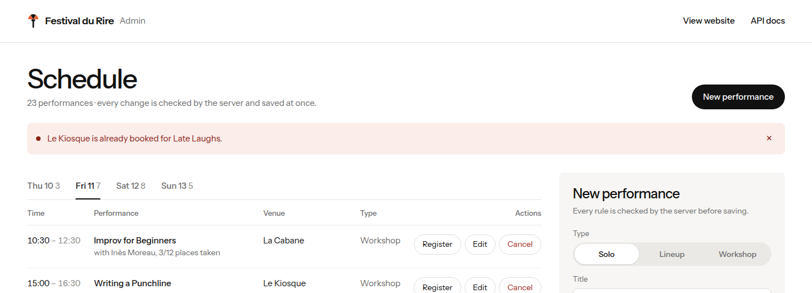

| Message (exemples) | Pourquoi |
| --- | --- |
| `Le Kiosque is already booked for Late Laughs.` | il faut 30 minutes entre deux spectacles d'un même lieu |
| `Nora Lebrun is on stage in Nothing Serious.` | un artiste ne peut pas être à deux endroits à la fois (avec 30 minutes d'écart) |
| `2027-06-20 is not a day of the festival.` | le festival dure du 10 au 13 juin |
| `A lineup must have at least two acts.` | un plateau a au moins deux numéros |
| `Duration must be between 1 and 360 minutes.` | durée hors limites |
| `Improv for Beginners is full.` | plus de place dans l'atelier |
| `An artist named 'Zoé Tanguy' already exists.` | artiste déjà présent |

Dans la ligne de commande, le même message s'affiche après `Error:` :

```
$ uv run deauville artist personne
Error: No artist 'personne'.
```
