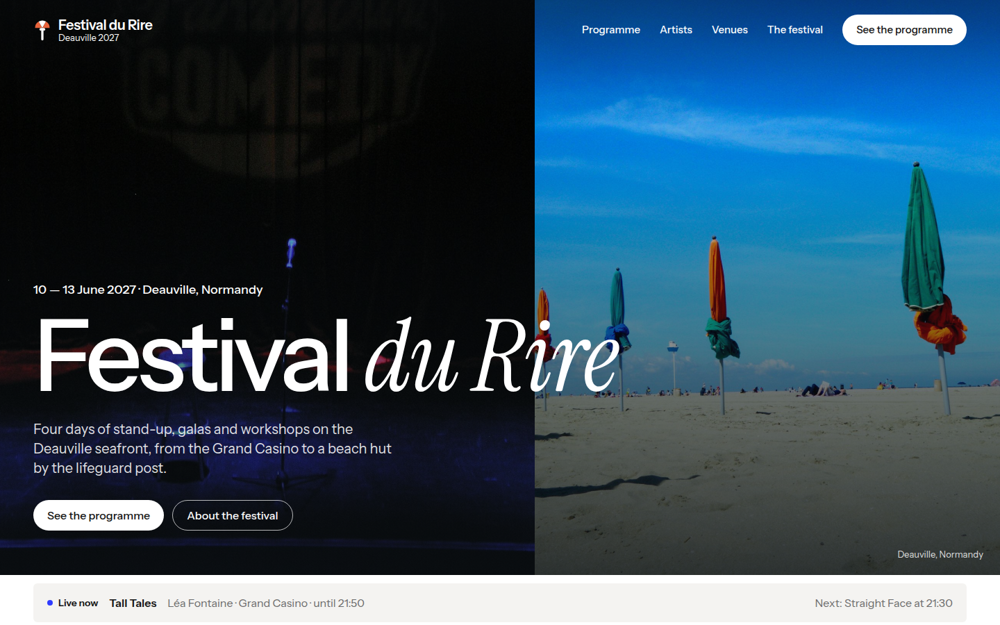
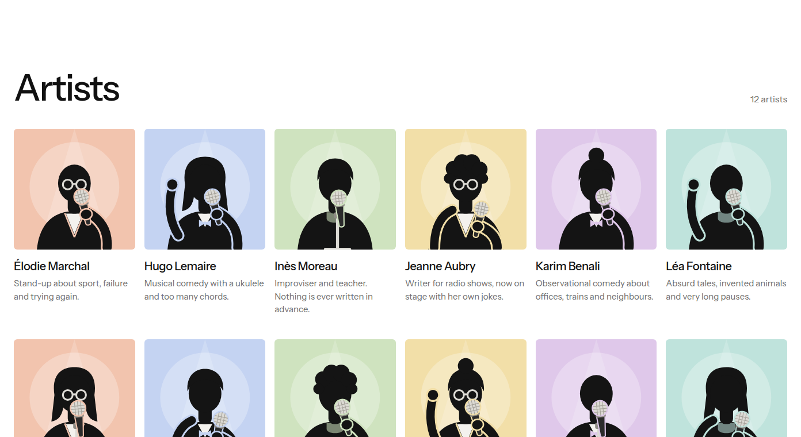
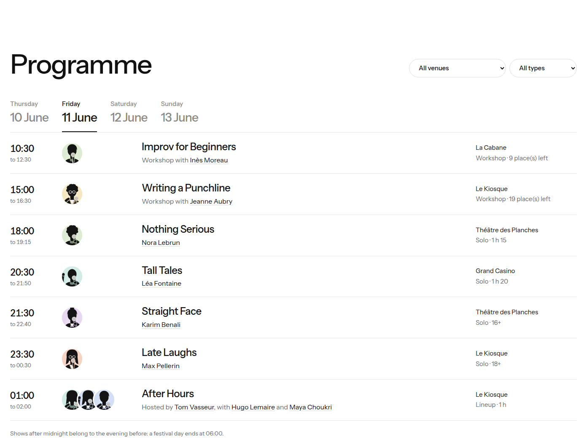
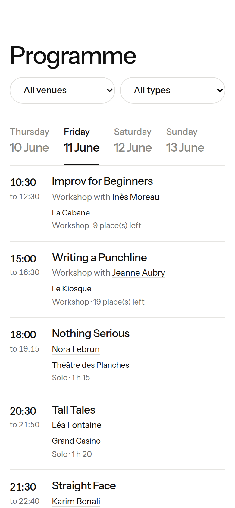
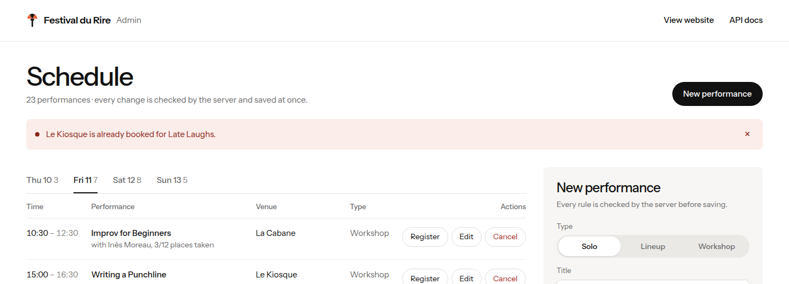

# Interface : le site et l'admin

Le site public et l'admin sont du HTML, du CSS et du JavaScript sans
framework, servis par le même serveur que l'API. Ils ne contiennent **aucune
règle du festival** : ils affichent ce que l'API renvoie et lui envoient les
demandes.

[← Retour au README](../README.md)

## Sommaire

- [Les fichiers](#les-fichiers)
- [Qui appelle quoi](#qui-appelle-quoi)
- [Le design](#le-design)
- [Photos, logo et portraits](#photos-logo-et-portraits)
- [Téléphone et ordinateur](#téléphone-et-ordinateur)
- [Comment l'admin gère une erreur](#comment-ladmin-gère-une-erreur)

## Les fichiers

```
web/
├── public/
│   ├── index.html     l'accueil : ouverture, chiffres, programme, histoire, artistes, lieux
│   ├── artist.html    la page d'un artiste (artist.html?slug=max-pellerin)
│   ├── app.js         tout le JavaScript du site, portraits dessinés compris
│   ├── style.css      les styles, partagés avec l'admin
│   ├── favicon.svg    le logo, en icône d'onglet
│   └── images/        les photos (Wikimedia Commons, voir credits.md)
└── admin/
    ├── index.html     le planning et les formulaires
    ├── admin.js       tout le JavaScript de l'admin
    └── admin.css      ce qui est propre à l'admin
```

`api.py` les sert avec `StaticFiles` : `web/admin/` sur `/admin`, puis
`web/public/` sur `/`. L'ordre compte : `/` attrape tout, donc `/admin` est
monté avant.

## Qui appelle quoi

| Écran | Appels à l'API |
| --- | --- |
| Accueil | `GET /api/festival` (dates, jours), `GET /api/venues` (filtre, lieux, total des places), `GET /api/artists` (artistes, couleurs, photos), `GET /api/programme` (chiffres clés et aperçu des 4 jours), `GET /api/now` (bandeau « Live now ») |
| Programme | `GET /api/programme?day=…&venue=…` à chaque changement de jour ou de lieu ; le filtre par type est fait dans le navigateur |
| Page artiste | `GET /api/artists/{slug}` (l'artiste et ses passages), `GET /api/artists` (photos des artistes liés) |
| Admin, chargement | `GET /api/venues`, `GET /api/artists`, `GET /api/programme` |
| Admin, actions | `POST /api/performances`, `PUT /api/performances/{id}`, `DELETE /api/performances/{id}`, `POST /api/performances/{id}/participants`, `POST /api/artists` |

Le contrat complet de ces routes est dans [API.md](../API.md).

### « Live now » et le paramètre `?at=`

Le bandeau appelle `/api/now`. Ajouté à l'adresse de la page, `?at=` est
transmis à l'API pour simuler un moment :

```
http://127.0.0.1:8000/?at=2027-06-11T21:00   →   GET /api/now?at=2027-06-11T21:00
```

Selon la réponse, le bandeau montre le spectacle en cours et le suivant, la
date d'ouverture (avant le festival) ou « The festival is over » (après).

## Le design

Inspiré des grands sites de festivals (Just for Laughs, Festival d'Avignon,
Sónar) : de grandes images, une typographie calme, beaucoup d'espace, et une
identité reconnaissable.



| Élément | Choix |
| --- | --- |
| Ouverture | deux photos côte à côte : une scène de stand-up (on rit) et les parasols de Deauville (on est à Deauville) |
| Logo | un micro dont la tête est un parasol de Deauville, rayé orange et noir (SVG, dans l'en-tête et l'icône d'onglet) |
| Polices | [Instrument Sans](https://fonts.google.com/specimen/Instrument+Sans) pour tout le texte, [Instrument Serif](https://fonts.google.com/specimen/Instrument+Serif) en italique pour « du Rire » ; chargées depuis Google Fonts |
| Couleurs | noir `#111111` sur blanc, gris pour le texte secondaire, un bleu (`#2F3BFF`) pour le point « Live now », et une couleur douce par artiste |
| Titres | grands mais en poids moyen, lettres resserrées (`letter-spacing: -0.04em`) |
| Boutons | en pilule ; noir pour l'action principale, blanc ou contour sur les photos |
| Effets | voile sombre sur les photos pour lire le texte, léger zoom au survol des lieux ; désactivés si l'utilisateur demande moins d'animations |

L'accueil se lit de haut en bas : l'ouverture, le bandeau « Live now », les
chiffres clés (calculés à partir de l'API), l'aperçu des 4 jours, le
programme, l'histoire du festival, les artistes, les lieux et une photo des
Planches en pied de page.

Toutes les couleurs sont des variables CSS au début de
[style.css](../web/public/style.css) (`--ink`, `--muted`, `--accent`…) :
changer une couleur partout, c'est changer une ligne.

## Photos, logo et portraits

**Les photos** des lieux, de l'ouverture et de l'histoire viennent de
Wikimedia Commons, sous licence libre ; auteurs et licences sont dans
[credits.md](credits.md) et dans le pied de page du site.

**Les artistes du projet sont fictifs** : aucune photo de personne réelle ne
les représente. Chacun a un **portrait dessiné** en SVG par `portraitSvg()`
dans `app.js` : une silhouette d'humoriste au micro, sur la couleur de
l'artiste. Quatre poses (micro à la bouche, bras levé, micro sur pied, micro
tenu bas), cinq coiffures, trois tenues et des lunettes pour un artiste sur
trois donnent un portrait différent à chacun.



Les couleurs et les portraits suivent l'ordre alphabétique des artistes : deux
voisins n'ont jamais la même couleur, et un artiste a le même portrait sur
toutes les pages, en grand sur sa page, en médaillon dans le programme.

```js
function photoHtml(name, photoUrl) {
  if (photoUrl) {
    return `<div class="photo"></div>`;
  }
  return `<div class="photo portrait">${portraitSvg(name)}</div>`;
}
```

Dès qu'un artiste a un `photo_url` (champ « Photo URL » du formulaire
« New artist » de l'admin), sa vraie photo remplace le dessin, partout.

## Téléphone et ordinateur

| Ordinateur | Téléphone |
| --- | --- |
|  |  |

Une seule feuille de styles ; en dessous de 820 px de large :

- les deux photos d'ouverture passent l'une au-dessus de l'autre ;
- le bouton « See the programme » de l'en-tête disparaît (le lien
  « Programme » reste) ;
- les titres passent de 64 à 40 px ;
- les chiffres clés et les 4 jours passent sur deux colonnes ;
- chaque ligne du programme passe sur deux colonnes, sans les médaillons ;
- les filtres se partagent la largeur ;
- dans l'admin, les champs côte à côte passent l'un sous l'autre, et le
  tableau défile horizontalement.

Aucune page ne défile horizontalement à 375 px de large.

## Comment l'admin gère une erreur

`admin.js` n'essaie jamais de deviner si une demande est valide. Il envoie la
demande, et si le serveur refuse, il affiche la phrase reçue :

```js
async function callApi(method, url, body) {
  // … envoie la requête …
  const data = await response.json();
  if (!response.ok) {
    throw new Error(errorText(data));   // la phrase de l'API
  }
  return data;
}
```

`errorText` gère les deux formes de `detail` décrites dans API.md : une
phrase (erreur du festival) ou une liste de problèmes (corps de mauvaise
forme, refusé par FastAPI).



Une règle n'existe donc qu'à un seul endroit, dans les classes Python. Si une
règle change, l'admin n'a rien à modifier.
